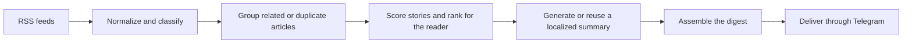

# Telegram News Intelligence Bot

A Telegram bot that turns RSS coverage into personalized news digests in English, Uzbek, and Russian. FastAPI handles preferences and digest previews, Celery runs the pipeline, and aiogram delivers the results.

## How it works



The collector persists normalized articles and story clusters in PostgreSQL. The ranking stage considers source reliability, freshness, category and user interests. The current vector representation is a deterministic lexical baseline. Gemini is used for summaries when configured.

## Example digest

The following examples use sample content and the same formatting as the bot.

**English**

```text
📰 Your news digest

1. Tashkent extends evening bus service on two routes.
```

**Uzbek**

```text
📰 Sizning yangiliklar to'plamingiz

1. Toshkentda ikki yo‘nalishda kechki avtobus qatnovi uzaytirildi.
```

The bot supports on-demand previews with `/news`. Users can change their language, interests, and delivery preferences with `/language`, `/interests`, and `/settings`.

## Run locally

Use Python 3.12, PostgreSQL 16 with pgvector, and Redis 7. Docker Compose can start the stack and apply its migrations.

```bash
cp .env.example .env
docker compose -f docker/docker-compose.yml up --build
```

Set `TELEGRAM_BOT_TOKEN` for Telegram delivery and `GOOGLE_API_KEY` for Gemini summaries in your local `.env`. For local testing of the API and formatter, use the test suite with its dedicated database.

| Local endpoint | Purpose |
| --- | --- |
| [Swagger UI](http://localhost:8010/docs) | Explore API routes and schemas |
| [Health](http://localhost:8010/health) | Check the API process |
| [Readiness](http://localhost:8010/health/ready) | Check API and database readiness |
| [Metrics](http://localhost:8010/metrics) | View application counters |

To run the backend without Docker, install the development dependencies, configure `.env`, run `python -m alembic upgrade head` against the development database, then start `uvicorn backend.main:app --reload`. Seed categories and sources with `python -m backend.db.seed` and `python -m backend.db.seed_sources`, in that order.

## Verify the project

Create a separate PostgreSQL database with pgvector available. Set both URLs to that test database when applying migrations and running the suite.

```bash
python -m pip install -e ".[dev]"
export TEST_DATABASE_URL='postgresql+asyncpg://postgres:<local-password>@127.0.0.1:5432/newsbot_test'
export DATABASE_URL="$TEST_DATABASE_URL"
python -m alembic upgrade head
python -m ruff check .
python -m pytest -q
```

The tests exercise the news pipeline, duplicate detection, digest ranking and rendering, API permissions, and PostgreSQL constraints. Telegram and AI provider responses are simulated in the test suite.

## Code map

| Directory | Purpose |
| --- | --- |
| [`bot/`](bot/) | Telegram handlers, keyboards, and localization |
| [`backend/`](backend/) | API routes, database migrations, and service logic |
| [`pipeline/`](pipeline/) | Feed collection, story clustering, relevance, and summaries |
| [`workers/`](workers/) | Celery tasks and schedule |
| [`tests/`](tests/) | Unit and integration tests |

Source management is available under `/api/v1/sources` using `X-Admin-Token`. Bot-facing settings and digest APIs use `X-Internal-Token`. See [`.env.example`](.env.example) for configuration and [the project overview](OVERVIEW.md) for the component list.
